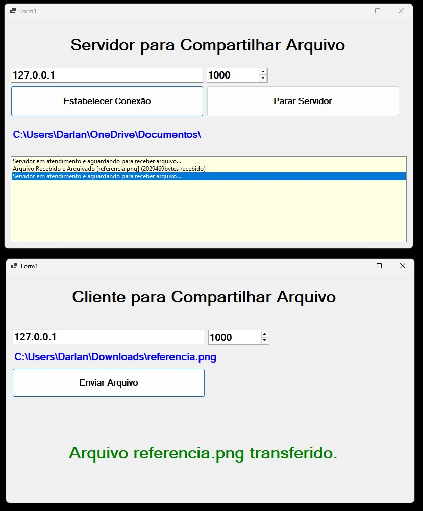

# Socket Arquivos WinForms

Transferência de arquivos entre duas aplicações via **TCP Sockets** em **C# Windows Forms**: um **Servidor** que recebe e salva arquivos, e um **Cliente** que escolhe e envia um arquivo.



## Funcionalidades

- **Servidor**: escuta em um IP e uma porta configuráveis, recebe o arquivo e salva em `Documentos`, com log de cada recebimento e do tamanho em bytes
- **Cliente**: escolhe um arquivo e envia para o servidor
- O servidor volta a aguardar automaticamente após cada arquivo
- Botão para parar o servidor

## Estrutura

```
SocketArquivosWinForms/
├── TransferirArquivoServer/   # Aplicação servidor (recebe arquivos)
└── TransferirArquivoCliente/  # Aplicação cliente (envia arquivos)
```

## Como funciona (protocolo)

O cliente envia os dados nesta ordem pela conexão TCP:

| Parte | Tamanho | Conteúdo |
|---|---|---|
| 1 | 4 bytes | Tamanho do nome do arquivo (`int`) |
| 2 | N bytes | Nome do arquivo (UTF-8) |
| 3 | restante | Conteúdo do arquivo |

Ao terminar, o cliente fecha a conexão (`Shutdown` + `Close`). Para o servidor, isso é o sinal de que o arquivo chegou inteiro: o `Receive` devolve `0`.

## Como executar

1. Abra e execute o **TransferirArquivoServer**
2. Confira o IP e a porta (padrão `127.0.0.1:1000`) e clique em **Estabelecer Conexão**
3. Abra e execute o **TransferirArquivoCliente**
4. Use o mesmo IP e a mesma porta, escolha um arquivo e clique em **Enviar Arquivo**
5. O arquivo é salvo na pasta `Documentos` do usuário que está rodando o servidor

## Bugs corrigidos durante o desenvolvimento

- **Tamanho negativo no log (`-21 bytes`)**: o log usava o valor da última leitura (sempre `0`). Agora os bytes de cada leitura são somados em um contador.
- **Socket fechado dentro do laço de leitura**: arquivos que chegavam em mais de uma leitura causavam `ObjectDisposedException`. O fechamento passou para depois do laço.
- **Servidor não detectava o fim do arquivo**: o cliente agora chama `Shutdown(SocketShutdown.Send)` e `Close()` depois de enviar.

## Tecnologias

- C# / .NET
- Windows Forms
- `System.Net.Sockets` (TCP)
- `System.IO` (`BinaryWriter`)

## Autor

**Darlan Rosendo**: [github.com/darlanrosendo](https://github.com/darlanrosendo)
